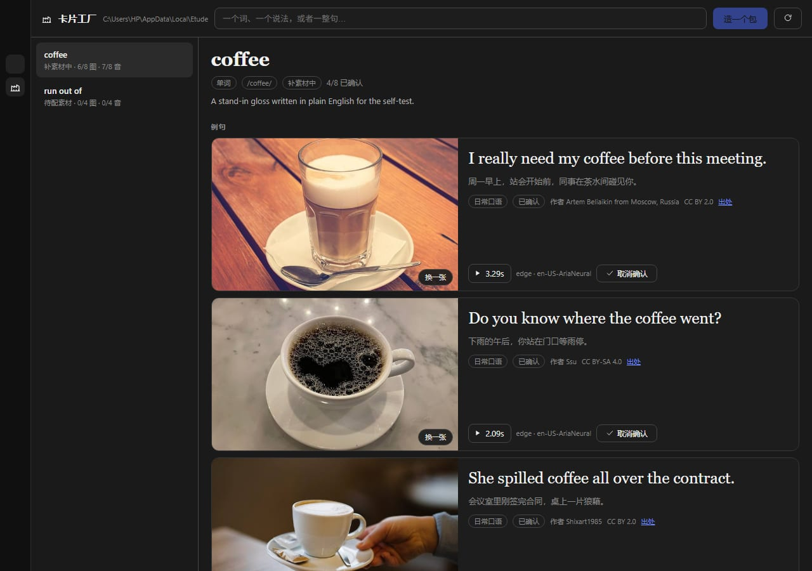
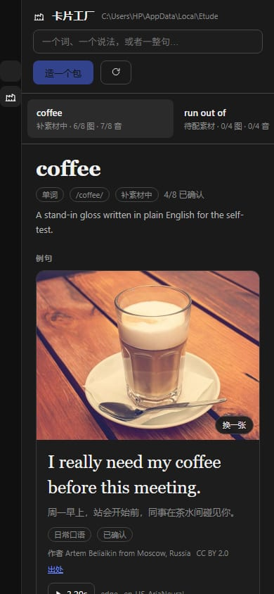
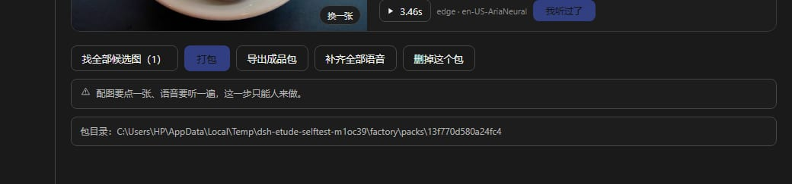

# dsh-etude · 卡片工厂

**DeepSeek Harness 插件：把「一个词」做成一整套能练的语言卡片。**

给它一个词、一个固定说法、一句英文，它把卡片造出来 —— 8 条互不相同场景的例句、
每条例句一张对得上情境的实拍照片、一条能听清语气的语音，逐句人工确认后打成一个
自包含的 v2 卡片包，导出到本地目录。

**整条链路都在这个插件里闭环**：造例句、搜图、像素预检、九宫格挑图、TTS 合成、
试听确认、打包、契约校验、导出。不依赖任何外部应用、不需要额外数据库、不需要
另起服务。

```
侧栏「卡片工厂」→ 输入 coffee → 造包
  → 8 条例句（场景互不相同，中文说法故意不一致）
  → 每条 9 张候选实拍图，你点一张（或者自己上传）
  → 每条语音，真播一遍，播到六成才许点「我听过了」
  → 打包：缺图、缺复核、哈希不对，都不给打
  → 导出：Downloads/dsh-etude/coffee-<id>/ 里就是成品
```

> 现状：**0.1.0，能用**。真模型造过 8 目标 × 8 条例句，零 flag；配图走 Wikimedia
> Commons 实拍图，每张都人工点过；语音走 Edge TTS（零配置、不要 key），也能接
> OpenAI 兼容的 TTS。



挑图的那一条会切上下布局，九宫格铺满整卡宽 —— 缩略图太小就等于让人瞎点：


窄屏（390px）下卡包列表变成横向一溜，卡片转上下布局：



底部那排动作：批量取候选图（只取货、不替你点头）、打包、导出、补齐语音、删包。



---

## 教程

两份，一份慢慢看、一份先过一遍骨架：

- **[操作手册](docs/GUIDE.md)** —— 十八节，从「什么都没装」讲到「拿到一个能用的包」。
  每个按钮叫什么、每行提示什么意思、哪一步会被拒、为什么被拒，都写了；配十一张界面
  截图（第一次打开 / 正在造 / 卡片三层 / 九宫格 / 语音行 / 导出横幅 / 设置页 …）。
- **[视频教程](docs/video/dsh-etude-tutorial.mp4)** —— 6 分钟，中文旁白，讲同一件事的
  骨架。画面和旁白都是代码生成的：改 `docs/video/narration.mjs` 里一行字重跑一遍，
  片子自己变长变短，不用重录。做法见 [docs/video/README.md](docs/video/README.md)。

---

## 为什么这么设计

这三条不是功能，是拒绝：

**1. 每张图都有人点过头。** 检索候选 → 预检 → 九宫格挑图 → 锁定。没有「自动配好
就入库」这条路。一条例句给 9 张候选、三列铺满整卡（每格约 300×225），是因为
小于 150px 的缩略图根本看不出拍的是什么，那叫让人瞎点。

**2. 试听必须真能播。** 界面上是真正的 `<audio>`，播到六成才解锁「我听过了」；
合成只回字节数、不给可播放的东西，这个插件不会认为它成了。

**3. 重复的目标不重复收费。** 幂等键 = `hash(target, kind, language, examples,
zhVariants, model, promptVersion, voice)`。同参数再点一次「造包」，直接复用上次的
包，一分钱不花；失败的包不复用（不然永远卡在失败的那份上）。

契约里把前两条写成了硬校验：`review.image.by` / `review.audio.by` 没值、
`audio.listened !== true` 的包，`contract/validate.*` 一律拒收 —— 物理上打不出来。

---

## 装上

```powershell
cd <本仓库>
npm install          # 只有两个运行依赖：sharp（像素体检）、ws（Edge TTS 的 WebSocket）
```

然后在 DSH 里把本目录当 bundle 装：

```
plugin_manager  install_bundle  target: "<本仓库的绝对路径>"
```

改完代码要重新加载宿主半时，`set_plugin` 的 target 是 **entryId `include:etude`**，
而且必须先 `enabled=false` 再 `enabled=true`（`changed:false` 时它不会重跑）。

## 用起来

**界面**：侧栏「卡片工厂」。左边是包列表，右边是整包。

包头上是一条**五步流水线**：例句 → 配图 → 语音 → 打包 → 导出。每步一格，写清
这一步的进度和「要你做什么」（比如「3 条等你点头」），底下还有一行「现在这一步」。
任务在跑的时候流水线会自己刷新，候选图落地一张就出现一张 —— 可以边等边点，
不用等整批跑完。

先按底部的「找全部候选图」把八条的候选一次取回来（这一步只是去图库取货，不替你
挑），然后逐条「点一张 → 生成语音 → 我听过了」，全绿之后「打包」，再「导出成品包」。

**工具**（让 Agent 自己招呼，但**复核这一步刻意不给工具**）：

| 工具 | 参数 | 干什么 |
|---|---|---|
| `etude_create` | `target` 必填，`kind` / `examples` / `prepareImages` | 造一个包（同步等它造完） |
| `etude_status` | `packId` 可选 | 哪几条还差图、哪几条还差试听 |
| `etude_pack` | `packId` 必填，`export` 可选 | 打包；`export:true` 顺手导出 |

**命令行自检**（假模型顶替 LLM，其余全真：真去 Commons 搜图、真跑 Edge TTS）：

```powershell
node tests/selftest.mjs --target coffee --examples 4 --candidates 9 --keep
node tests/selftest.mjs --target coffee --examples 8 --export
```

**测试**：

```powershell
npm test                                    # JS 单元 18 条 + 客户端渲染冒烟 + RPC 冒烟 49 项
npm run test:py                             # 契约双份校验器 + 像素守卫反证，16 条
```

---

## 设置

| 键 | 默认 | 说明 |
|---|---|---|
| `dataDir` | 空 = `%LOCALAPPDATA%\dsh-etude` | 账本、素材、成品包都在这 |
| `exportDir` | 空 = `%USERPROFILE%\Downloads\dsh-etude` | 导出往哪儿放 |
| `language` | `en` | 目前只有 `en` 能生成 |
| `examplesPerLesson` | `8` | 1–40 |
| `zhVariants` | `3` | 每句几种**故意不一致**的中文说法，2–4 |
| `provider` / `model` | 空 = 跟随当前会话 | 造例句用哪个模型 |
| `llmBaseUrl` / `llmApiKeyEnv` / `llmModel` | 空 | 想用 OpenAI 兼容端点时才填 |
| `candidateLimit` | `9` | 每条给几张候选图，3–12 |
| `autoPrepareCandidates` | `true` | 造完例句顺手找候选图 |
| `pixelCheck` | `true` | 用像素统计挡纯色块、渐变、大色块海报 |
| `ttsEngine` | `auto` | `auto` / `edge` / `openai`；Edge 永远兜底 |
| `rate` / `volume` | `+10%` / `+10%` | Edge 用这种写法，OpenAI 兼容会换算成 `speed=1.1`（没有 volume） |
| `ttsVoiceEdge` | `en-US-AriaNeural` | Edge 音色短名，面板里有完整音色表 |
| `ttsBaseUrl` / `ttsApiKeyEnv` / `ttsModel` / `ttsVoice` | 空 | 想接 OpenAI 兼容 TTS 时才填 |
| `proxyUrl` | 空 = 自动读 `HTTPS_PROXY` 与系统代理 | 搜不到候选图先看这里 |

API key 不写在设置里，只写「存哪个环境变量名」，值放 DSH 的凭据里。

---

## 成品包长什么样

```
coffee-13f770d580a24fc4/
├── cards.html          双击就能看：图、句子、播放器都在这一页
├── manifest.json        清单：包里有什么、谁点过头
├── images/              每条例句一张实拍图
└── audio/               每条例句一条 mp3
```

`cards.html` 是导出时顺手生成的静态页：不联网、不依赖任何服务，图片音频走同目录
相对路径，整个文件夹拷走也能看。包是给人用的，不该只有一堆哈希命名的文件。

`format: "card-pack"`、`format_version: 2`。结构在
[`contract/manifest.schema.json`](contract/manifest.schema.json)，表达不出来的规矩在
[`contract/validate.js`](contract/validate.js) 与 [`contract/validate.py`](contract/validate.py)：
**两份逐条对齐，测试里同一批好包坏包同时喂给两边，判定必须一致。**

校验器管的是那些 schema 说不出来的事：文件真的在不在、sha256 和文件对不对得上、
图短边 ≥640、音频能读出时长、有没有人复核过、同句有没有重复、同一个文件有没有
被两条例句抢。

老包的 `format` 写的是 `etude-lesson`，现在写 `card-pack`，**两个都认**（用老值会
给一条 warning）。改名是因为「这个包属于谁」不该由别人定义 —— 包是这套契约的，
不是某个应用的。

每条例句还带两个附加字段：`voice_hint`（怎么说这句：语气/快慢/情绪）与
`image_query`（图是怎么搜来的）。每张图带 `source / query / license / author /
credit_url`，缺授权信息只警告、不拦交付 —— 但那种包别对外发。

## 数据落在哪

```
%LOCALAPPDATA%\dsh-etude\
├── factory/library.json           账本：包、例句、复核记录（真源，不是内存）
├── factory/media/images|audio     内容寻址的媒体（<source>-<sha256[:20]>.<ext>）
├── factory/packs/<id>/            打好的成品包
├── factory/candidates/            还没选中的候选图（换一批就删）
└── staging/<id>/                  打包中转（校验不过会留着让人查）
```

媒体名是 `<小写字母>-<sha256 前 20 位>.<ext>`。这不是随手起的：名字只由内容决定，
所以同一份字节不管被哪个包用、被复制到哪，都还是同一个名字，重复的自动只存一份。

---

## 已知的坑（都踩过，别再踩）

- **Node 的 `fetch` 不读系统代理。** 走 Clash 之类时，直连 Openverse / Commons 会
  卡到超时。`lib/net.js` 按「设置 → 环境变量 → Windows 注册表 → 直连」显式解析，
  走 CONNECT 隧道；没有代理时零额外开销。注意搜不到图时先看 `proxyUrl`。
- **Openverse 会抽风。** 同一个 query 一会儿 200 一会儿 504。所以每个搜索有内存缓存
  （8 条例句的 `image_query` 常常撞车，不缓存第二条起白等十几秒），并且连错 3 次
  本次进程就不再用它，Commons 顶上。
- **渐变图能骗过方差。** 纯色块 `stdev < 6` 就够了，但线性渐变 `stdev` 能到 73。
  必须看**二阶差分**（`secondDiff < 1.1` 判渐变）。大色块海报看 `uniqueRatio`。
  这三种都真造了图跑过验证。
- **`output.schema` 是 Harness 的 value schema DSL，不是 JSON Schema。** 必填写在
  属性上（`{ type: 'string', required: true }`）；写成 `required: [...]` 数组会让整个
  插件激活失败，报 `schema.required is not supported by the value schema DSL`。
- **宿主 web 服务整站要鉴权。** `` 这种子资源带不上 token，
  会 401。所以界面的图和音频都走 RPC 拿字节、转 blob URL，不走 HTTP 路由。
- **同一个绑定名不能自己在同一条语句里调用自己。**
  `const [packs, selfcheck] = await Promise.all([listPacks(root), selfcheck()])`
  里右边的 `selfcheck()` 命中的是正在声明的局部绑定（TDZ），面板打开就白屏。
- **语速/音量不是所有引擎都认。** Edge 用 `+10%`，OpenAI 兼容用 `speed=1.1` 且没有
  volume。原样透传会让参数静默失效，所以这里按引擎换算。

## 仓库结构

```
index.js           Host 半入口：Config、RPC、媒体路由、三个工具、systemPrompt 段
client.js          Web UI 半：侧栏图标 + 主面板 + 配置卡（零依赖，手写 SVG）
lib/
  prompts.js       Etude 那套七条 HARD RULES 原文 + 本插件加的三处约束
  examples.js      造例句、确定性校验、不过关带意见重试一次
  images.js        检索（Openverse/Commons）、像素预检、内容寻址落盘
  tts.js           引擎选择与降级；tts-edge.js 是 Edge WebSocket 的纯 JS 实现
  packs.js         状态机：造包 → 配素材 → 打包；所有复核闸门都在这
  export.js        导出成品包到本地目录
  manifest.js      camelCase → 契约 v2 的 snake_case
contract/          清单 schema + 两份同源校验器（JS / Python）
tests/             单元、客户端渲染冒烟、RPC 冒烟、整链路自检、pytest
docs/              GUIDE（操作手册）、DESIGN（十条决定，每条都写了否掉的另一个选择）、
                   HANDOVER、assets（README 与手册用的截图）
docs/video/        教程视频与生成它的代码（narration.mjs 逐字稿 + build.mjs 渲染器）
```

## 许可

MIT
