# 卡片工厂 · 操作手册

这份手册从「什么都没装」讲到「拿到一个能用的卡片包」，中间每一个按钮、每一行提示、每一个会被拒的地方都写了。第一次用照着做一遍，大约二十分钟（其中一半是等图库和等语音）。

配套还有一个同内容的视频：`docs/video/dsh-etude-tutorial.mp4`。视频快，手册全 —— 卡住了回来看手册。

---

## 0. 这东西到底做什么

给它**一个词、一个固定说法，或者一整句**，它给你造一包卡片。包里每条卡片三样东西：

- 一句**真人真会说的话**（不是教科书例句）
- 一张**有人挑过的真照片**
- 一条**有人真的听过**的语音

然后你把这一包导出来，谁想练就拿去练。

三条硬规矩，整个设计都是围着它们转的：

| 规矩 | 为什么 |
| --- | --- |
| **每张图都得有人点过头** | 图库检索出来的东西经常图文不符。自动配好的图，人一看就知道是机器糊的，然后整个方法就没人信了 |
| **试听必须真能播** | 「合成成功、返回 30000 字节」和「耳机里听得见」是两件事。接口通了不代表声音能出来 |
| **同样的东西不重复花钱** | 同一个词、同样的参数造第二遍，直接复用第一遍的结果，不再调模型、不再搜图、不再合成 |

所以这个插件**故意不给你「一键全自动」**。造例句、找候选、打包、导出都可以批量；**挑图和听声必须你自己来**。

---

## 1. 装之前

| 要求 | 说明 |
| --- | --- |
| DeepSeek Harness 桌面版 | 面板是一个 Web UI 插件，跑在 Harness 里 |
| Node.js ≥ 22.19 | 宿主自己带的 Node 就够，`sharp` / `ws` 需要这个版本 |
| 能上外网 | 例句要走宿主里的模型；配图要从维基共享（Commons）和 Openverse 搜；语音走 Edge 在线合成 |
| 代理（国内常见） | **Node 的 `fetch` 不读系统代理**。有代理软件的话，一会儿在设置页把地址填进去，否则搜图会一直超时 |

插件本体零构建：就是一个普通 npm 包，`index.js`（宿主半）+ `client.js`（浏览器半）+ `lib/`。不用编译，改完重载就生效。

---

## 2. 安装

### 2.1 拿到代码

```powershell
git clone https://github.com/whyao56/dsh-etude
cd dsh-etude
npm install          # 只装两个真依赖：sharp（读像素）、ws（Edge 的 WebSocket）
```

国内没代理的话 `npm install` 会很慢，先给 npm 配上：

```powershell
$env:HTTPS_PROXY='http://127.0.0.1:7897'
npm install
```

装完应该多出 `node_modules/sharp` 和 `node_modules/ws`。这两个不是可选的：少了 `sharp`，像素体检会降级成「只看尺寸」；少了 `ws`，Edge 语音直接不可用。

### 2.2 装进 Harness

让 Harness 把这个目录当成一个 bundle 装上（在会话里直接说，或者用插件管理入口）：

> 把这个目录装成插件：`F:\dsharness\dsh-etude`

底层动作是：

```
plugin_manager action:install_bundle target:"<仓库绝对路径>"
```

成功后返回里应该能看到 `dsh-etude 0.1.0 <- <你的路径>`。

### 2.3 确认它真的起来了

**不要看日志判断**，用这三种办法：

1. **左边图标栏**多一个工厂图标（三个尖顶的小房子）。点它就是面板。
2. **插件列表**里找到 `dsh-etude`，状态是 `active`。
3. 在会话里让它跑一句 `etude_status`，能回「一共 N 个卡片包」就说明宿主半活着。

### 2.4 改了代码之后怎么重载

装好的包是「软链」进 profile 的，改文件不用重装，但要**让它重新激活**：

```
plugin_manager action:set_plugin target:"include:etude" enabled:false
plugin_manager action:set_plugin target:"include:etude" enabled:true
```

两个坑：

- `target` 必须写 entryId **`include:etude`**。写 `dsh-etude` 或 `etude` 会回 `unknown-plugin`。
- 第二次调用如果回 `changed:false`，**不会真的重新激活**，必须真的先 `false` 再 `true`。

浏览器半（`client.js`）改了之后，还要**刷新页面**才会加载新代码。

---

## 3. 第一次打开

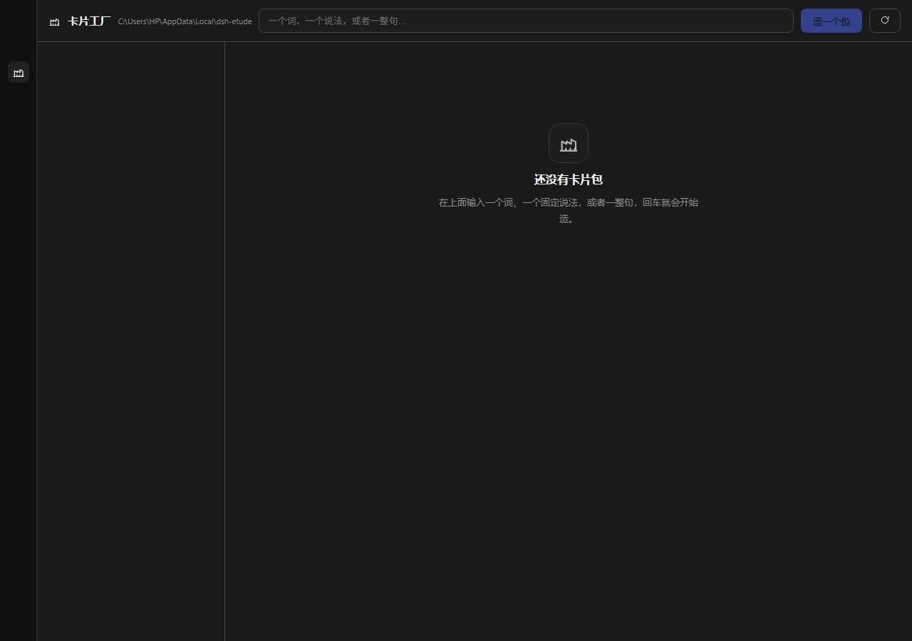

上面这一条是顶栏：

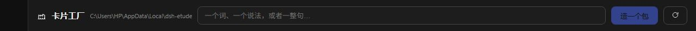

- 左边是标题「卡片工厂」，后面灰色那串是**数据目录**（默认 `%LOCALAPPDATA%\dsh-etude`），一眼能看到东西存哪。
- 中间是输入框，占位文字是「一个词、一个说法，或者一整句…」。
- 右边是主按钮「造一个包」，和一个小圆箭头「刷新」（重新读账本）。
- 顶栏下面一排两个标签：**制卡** 和 **学习**。制卡是你在这里造包，学习是拿造好的包练。
  左边那个包列表两个区共用 —— 本来就是同一批东西，只是看它的方式不同。

第一次打开中间是这样一句「还没有卡片包」，加一句下一步做什么。**左边列表空着是正常的** —— 它只列已经有的包。

### 3.1 左边那一列：检索与排序

包多起来以后，翻比造更花时间，所以列表顶上有两样东西：

- **检索框**：按目标、释义、中文都能搜。**记不全也能搜** —— 字面命中的优先，
  没命中就按「两个字一组」的重合率把相近的挑上来。搜不到会明说
  「没有对得上的包」，不会让你以为包丢了。
- **排序**：最近动过 / 按名字 / 欠得最多的在前 / 做得最全的在前。
  「欠得最多」按还差多少图和音算，适合一上来就想知道今天该干哪一包。

### 3.2 学习区

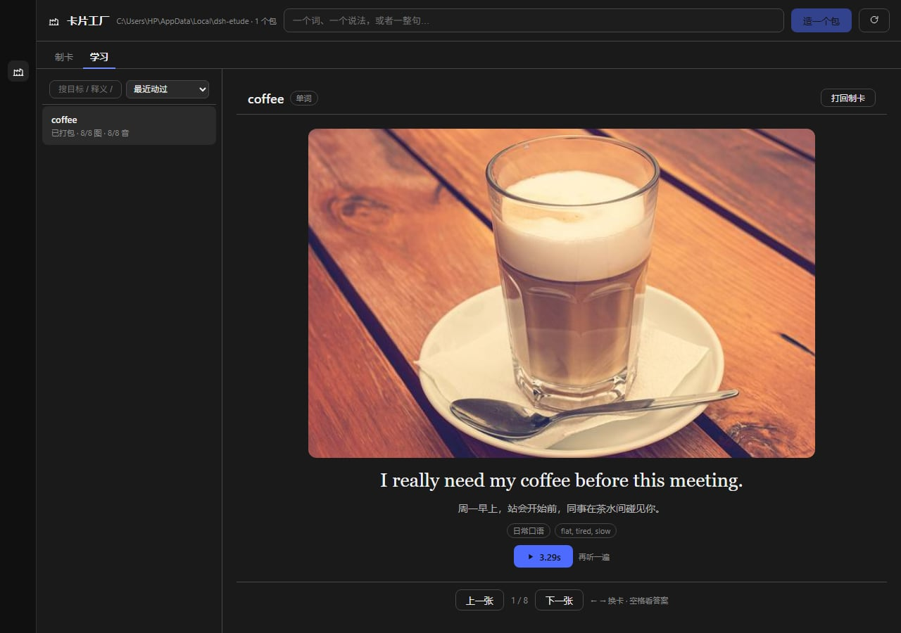

**这里只放能练的包。** 条件是三条都满足：已经打过包、每条都有图、每条都有音。
素材还在补的包留在「制卡」—— 缺口在的卡拿去练，练到一半发现没声没图，人就不练了。

一屏一张卡：图先出来，句子藏着。想一下这个场合你会怎么说，按
「想好了？看答案」翻开 —— 翻开后给句子、一种中文说法、语域和这一句的语气提示，
再点播放键听一遍。

键盘也能用：`←` `→` 换卡，空格翻开。手放在键盘上练的时候不用去够鼠标。

右上角「打回制卡」：把这一包退回制卡区重新编辑。它会把包的状态退回素材阶段，
流水线第 4、5 步（打包、导出）重新变成待办，于是一直到再打一次包之前，
它都不会出现在学习区。

> 磁盘上已经导出的那份副本不跟着删。你可能已经拷给别人了，
> 我们不去动别人手里的东西。

---

## 4. 造第一个包

### 4.1 输入什么

输入框里打的字会自己判类型，判成三种之一：

| 你打的 | 判成 | 判断依据 |
| --- | --- | --- |
| `coffee` | 单词 | 一个词 |
| `in the long run` | 短语 | 多个词，但不是句子开头 |
| `I could have sworn I left it here.` | 整句 | 有句末标点，或开头是 `I / you / he / she / we / they / this / there / who …`，或 ≥6 个词 |

判错了可以手动指定：Agent 侧的 `etude_create` 有 `kind` 参数，写 `word` / `phrase` / `sentence` 都行。

判型不是小事：它决定提示词怎么写。`get along with someone` 是四个词的**短语**，被当成句子的话，模型会开始造整句，方向从一开始就偏了。

### 4.2 点「造一个包」，然后等

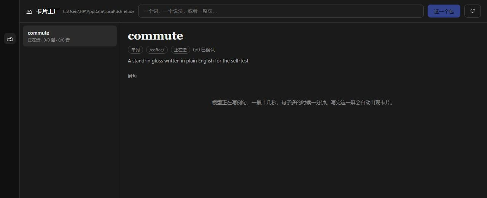

- 包会立刻出现在左边列表，状态「正在造 · 0/8 图 · 0/8 音」。
- 中间写「模型正在写例句，一般十几秒，句子多的时候一分钟」。
- 这一屏**不用手动刷新**，写完会自己出现卡片。

底层发生的事：把 Etude 的原始系统提示词（八条硬规则 + 场景不是翻译的教学理论）加上「场景必须互不相同」「`scene_zh` 只写场合不许翻译」「多给一个 `voice_hint`」「多给一个 `image_query`」四条附加要求，交给宿主里的默认模型，要求**只回一个 JSON**。

回来的 JSON 会被确定性校验一遍，这些情况会拦：

- 一句里没有目标词/短语（短语必须**原样**出现）
- 两句句子重复
- `scene_en` / `scene_zh` 为空，或者场景把句子抄进去了
- 两条的场景太像（词级相似度 > 0.86）
- 中文说法少于 2 个

有一项不过就带着「哪里不对」重试**一次**，取两次里问题更少的那份。两次都不行，包会变 `failed` 并记下原因 —— 这时候换个说法，或者稍后重试。

### 4.3 造出来之后

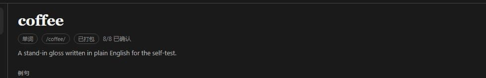

- 大标题是目标词，下面四个小标签：类型、音标、状态、`N/8 已确认`。
- 再下一行是英文释义（CEFR A2–B1 的简单英文，不许用中文，也不许用目标词自己解释自己）。
- 「例句」下面是八张卡片。

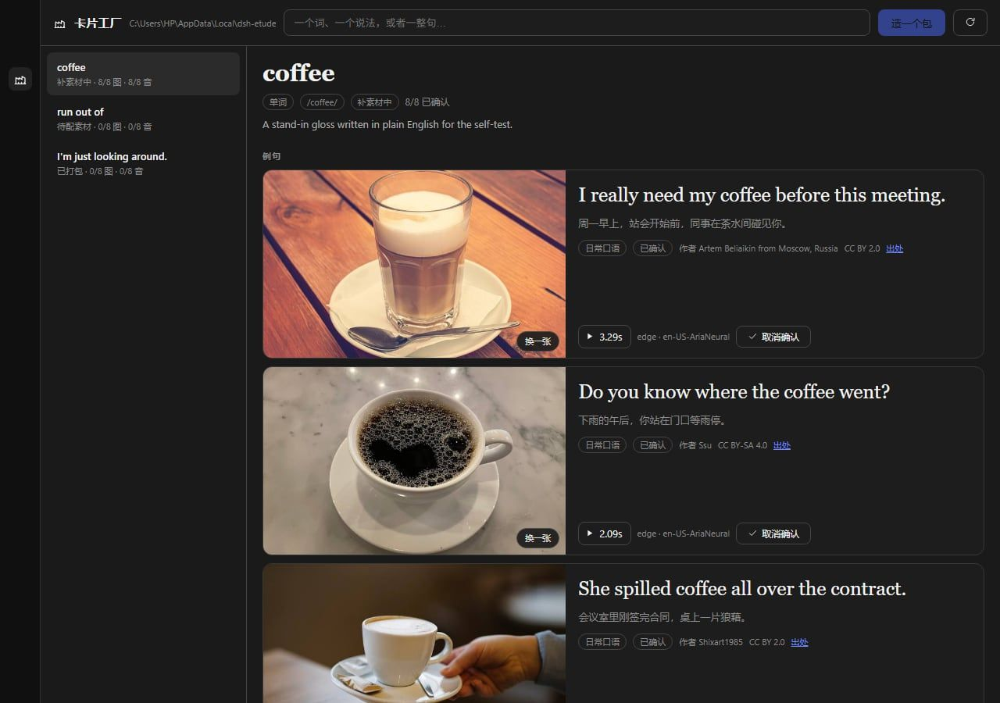

左边列表每一行都带**真实进度**：`8/8 图 · 8/8 音` 和状态。三种状态不一样：

| 状态 | 含义 | 下一步 |
| --- | --- | --- |
| 正在造 | 模型在写例句 | 等 |
| 待配素材 | 例句有了，图和音都没有 | 找候选图、合成语音 |
| 补素材中 | 至少有一部分素材了 | 继续补剩下的 |
| 已打包 | 打包过，包目录里有一套完整的 | 导出 |
| 已导出 | 导出到本地目录了 | 练 |
| 失败 | 造例句那步没过 | 看报错，重试 |

---

## 5. 读懂一张卡

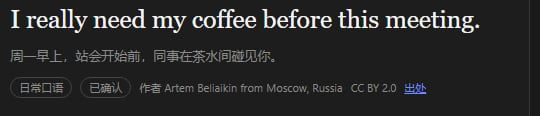

一张卡从上到下就三层，别塞更多：

1. **句子**（衬线、大、深色）——这是唯一要背的东西。
2. **场景**（一行、次级色）——**什么情况下会说这句话**。它**不是翻译**。
3. **元信息**（小字、更淡）——语域（日常口语/正式/书面/俚语）、是否已确认、图的作者与许可、出处链接。

关于中文那句话，有个刻意的设计：一包里同一句话会带 **2–3 种彼此不一致**的中文说法（一个极短口语、一个更完整、一个换个角度），每个包随机取一种显示。原因是怕你锁死「英文 A = 中文 B」这个映射 —— 那等于把语言练习退化成翻译练习。

### 语音那一行

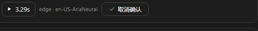

从左到右：播放键 + **真实时长**、实际用的引擎和音色、确认按钮。

- 时长是从 mp3 帧里算出来的，不是估的。
- `edge · en-US-AriaNeural` 是**实际用到的引擎**，不是你在设置里选的那个。配了 OpenAI 兼容的 TTS，但那天它挂了，这里会写 `edge`，包里也会记下 `fellBackFrom` / `fellBackReason`。

---

## 6. 配图

### 6.1 先「找候选图」（可以批量）

底部动作条第一个按钮是「**找全部候选图（N）**」，N 是「还没图、也还没候选」的条数 —— 不需要的时候这个按钮根本不出现。


点它会发生什么：

1. 每条拿去图库搜：维基共享（Commons）+ Openverse，每句最多试 3 个查询词。
2. 每条下 6–9 张候选，**每张都先过一遍体检**（见下）。
3. 过了的缩略图落到暂存目录，界面上就是九宫格。

八条一次大概一到两分钟（第一条最慢，后面几条命中搜索缓存会快很多）。某一条失败不会打断其它条，最后会告诉你哪几条没找到。

体检标准（挡掉的都在 `imageRejected` 里记着原因）：

| 项 | 阈值 | 挡什么 |
| --- | --- | --- |
| 短边 | ≥ 640 | 太小的图放到卡片上就糊了 |
| 文件大小 | ≤ 4 MB | 再大加载会卡 |
| 文件头嗅探 | 必须真是 jpeg/png/webp/gif | 挡住「200 + 一段 HTML」的假扩展名 |
| 亮度标准差 | ≥ 6 | 纯色块、白底 logo |
| **亮度二阶差分** | ≥ 1.1 | **线性渐变**。注意：渐变的方差并不小，只看方差全放过；必须看二阶差分 |
| 量化色数占比 | ≥ 0.02 | 大色块海报、纯文字图 |

### 6.2 然后逐条挑


- 一条句子下出现九张候选，**整卡铺开**（挤在图片那一栏里每张只有一百来像素，等于让你瞎点，所以挑图时卡片会变成纵向）。
- **单击**选中（看高亮），**双击**直接锁定。
- 底部三个按钮：「用这张」「换一批」「自己上传」。
- 「换一批」会重新搜（旧的暂存会清掉）。
- 「自己上传」走文件选择，上传的图**一样要过体检**；实在要强推（比如自己拍的图就是 500 像素），可以走 `pack.upload` 的 `force`，包里会记 `overridden: true`。

锁定之后：图片写进 `factory/media/images/`，文件名是 `来源-内容哈希前20位.jpg`，卡片右下角出现「换一张」。**同一个文件换到别的包会复用同一份字节**（内容寻址），不会存两遍。

### 6.3 图在哪、合规怎么办

每张图一起存下来的还有 `license` / `author` / `credit_url`。卡片上显示成「作者 XXX · CC BY 2.0 · 出处」，「出处」是指向原页面的链接。这不是装饰：Commons 上的图大部分要求署名，删掉这几项，包就不能用了。

---

## 7. 语音

### 7.1 合成

- 单条：语音那一行的「合成语音」。
- 全部：「补齐全部语音」（一条条来，单条失败不打断后面的）。

默认走 **Edge 在线合成**，不需要任何 key，零配置。一句大概 1–3 秒。

配了 OpenAI 兼容的 TTS（`ttsBaseUrl` + `ttsApiKeyEnv` 指向的那个 key）会**先试它**，失败自动退 Edge —— 退的时候不会静默：卡片上标实际引擎，包里记 `fellBackFrom` / `fellBackReason`。

语速/音量按引擎换算：Edge 直接给 `rate=+10%` / `volume=+10%`；OpenAI 那类接口只有 `speed=1.1`，**没有音量这个参数**，所以音量填了也不生效（设置页底部写了这句）。

### 7.2 必须听一遍

合成完成**不等于**能用了。要点播放，真的听到声音，「我听过了」那个按钮才会亮。

- 播放进度过 60% 才算听过（防止点一下播放键就点确认）。
- 播放失败会直接写「这个音频放不出来。可能文件没了，重新合成一次。」
- 确认之后才写 `audioReview: {by, at, listened: true}`，这一条才能进入打包。
- 点「取消确认」可以把确认退回（图也一样，有「换一张」）。

为什么这么较真：历史上最常见的一种「假成功」就是接口 200、返回了字节、界面显示「成功」，但文件是空的或者格式坏的，人戴上耳机才发现没声音。

---

## 8. 打包

底部「打包」。它会做四件事：

1. **先检查有没有缺件**：缺图的、缺语音的、图没点过的、语音没听过的，直接拒绝，并列出是第几条。
2. 在暂存目录 `staging/<包id>/` 下生成 `manifest.json` + `images/` + `audio/`。
3. 用**契约校验器**自己验一遍（哈希对不对、文件在不在、尺寸够不够、时长有没有）。
4. 验过了才整目录拷到 `factory/packs/<包id>/`，状态变「已打包」。

会看到的两种拒绝：

```
还不能打包：第 3 条缺配图；第 5 条语音还没试听
```

```
pack-invalid：导出副本没过校验：…
```

第二种少见但重要：校验不过时**暂存目录会保留**，方便你去看看到底哪张图坏了。

---

## 9. 导出

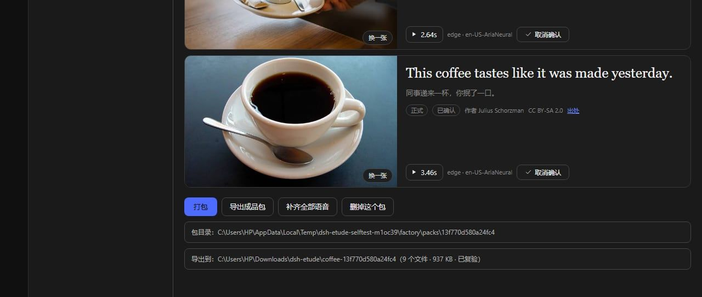

「导出成品包」。默认落到：

```
C:\Users\<你>\Downloads\dsh-etude\<目标词的短横线形式>-<包id>\
```

比如 `coffee-13f770d580a24fc4`。目标目录可以在设置页改。

导出这一步做了三件容易被忽略的事：

1. **先清空目标目录**。同一个包重导时，旧文件不会和新的混在一起。（清空前会校验这个目录确实在导出根之下、名字以 `-<包id>` 结尾，不对就报 `导出目录不对` 拒绝，宁可报错也不误删。）
2. **拷完拿导出那份再验一次**。源文件好不代表副本好（拷一半断了、坏块），所以校验的是副本自己的 `manifest.json` 和它引用的文件。
3. 验过了才记账，横幅上写「**已复验**」。老账本没有这个字段，会显示「未复验」。

失败会报 `export-invalid` 并明确说「源包还在，先别删」。

---

## 10. 成品包长什么样

```
coffee-13f770d580a24fc4/
├── manifest.json          8519 B
├── images/
│   ├── commons-34958284bf84a30c8729.jpg   352694 B  1920×1280
│   ├── commons-6f227aa4ad77f5b7bece.jpg   569998 B  1920×1440
│   ├── commons-0ad5c471ac38bdf486a.jpg    231777 B
│   └── commons-a3a5ad6f98018be9c3b8.jpg   401623 B
└── audio/
    ├── edge-1587b6105fb7f373b0dc.mp3       19728 B  3.288 s
    ├── edge-0a10e7f25badca7f9d64.mp3       20736 B  3.456 s
    ├── edge-1fb3d2af42401c52babd.mp3       12528 B  2.088 s
    └── edge-7713da9359933fba851c.mp3       15840 B  2.646 s
```

文件名里的 20 位十六进制是**内容哈希前 20 位**。好处：同一张照片被两个包用到，磁盘里只有一份；反过来，文件被改过一个字节，哈希立刻对不上。

`manifest.json` 的骨架（这是真跑出来的，只删了重复条目）：

```jsonc
{
  "format": "card-pack",
  "format_version": 2,
  "generator": {
    "kind": "dsh-plugin",
    "name": "dsh-etude",
    "version": "0.1.0",
    "model": "deepseek-flash",
    "prompt_version": "dsh-etude-1",
    "run_id": "13f770d580a24fc4"
  },
  "created_at": "2026-10-28T13:44:13.785Z",
  "lesson": {
    "target": "coffee",
    "kind": "word",
    "language": "en",
    "gloss": "A hot dark drink made from roasted beans.",
    "ipa": "/ˈkɒfi/",
    "note": "",
    "voice": { "engine": "edge", "voice": "en-US-AriaNeural", "rate": "+10%", "volume": "+10%" }
  },
  "examples": [
    {
      "ord": 1,
      "sentence": "I really need my coffee before this meeting.",
      "scene_en": "Office, Monday morning, before the standup begins.",
      "scene_zh": "周一早上，站会开始前，同事在茶水间碰见你。",
      "zh_variants": ["…", "…", "…"],
      "register": "日常口语",
      "voice_hint": "flat, tired, slow",
      "image_query": "coffee cup table",
      "media": {
        "image": {
          "file": "images/commons-34958284bf84a30c8729.jpg",
          "sha256": "34958284bf84a30c8729f151c10fc12b924bfc7815b40f5764ad64a86e8beeaf",
          "bytes": 352694, "width": 1920, "height": 1280,
          "source": "commons", "query": "coffee cup table",
          "license": "CC BY 2.0",
          "author": "Artem Beliaikin from Moscow, Russia",
          "credit_url": "https://commons.wikimedia.org/wiki/File:The_cup_of_coffee_on_a_wooden_table_(47939081677).jpg"
        },
        "audio": {
          "file": "audio/edge-1587b6105fb7f373b0dc.mp3",
          "sha256": "1587b6105fb7f373b0dc87cef9d11d1dbd7bb6564bf6cce72704f7e7bbf2671d",
          "bytes": 19728, "seconds": 3.288,
          "engine": "edge", "voice": "en-US-AriaNeural"
        }
      },
      "review": {
        "image": { "by": "local", "at": "2026-10-28T13:42:57.345Z", "candidates": 6, "picked": "…-1-1.jpg" },
        "audio": { "by": "local", "at": "2026-10-28T13:44:05.803Z", "listened": true }
      }
    }
  ],
  "swaps": [{ "role": "object", "original": "coffee", "candidates": ["tea", "water"], "samples": ["…"] }],
  "quality": {
    "examples": 8, "images": 8, "audios": 8,
    "min_image_short_edge": 1200,
    "flat_images": 0,
    "text_in_images": null,
    "pixel_analysis": "sharp",
    "reviewed_images": 8,
    "reviewed_audios": 8
  }
}
```

几个字段单独说：

- **`voice_hint`** 是给人看和给合成用的：`flat, tired, slow`。它会真的影响语速（含 `tired/slow/quiet` 这类词就降 10%，含 `excited/urgent` 这类就升 10%，上下限 ±18）。
- **`image_query`** 是当初搜图用的英文词组，留着是为了「这张图当初为什么会被搜出来」可追溯。
- **`review`** 是这一版契约的关键：**没有 `review.image.by` 和 `review.audio.listened === true` 的包，校验器直接判不合格**。也就是说，机器造的包永远达不到「成品」标准，必须有人经手。
- **`text_in_images`** 故意写 `null` 而不是 `0`。没有做文字检测，就不能假装是 0 张含文字的图。
- **`quality.flat_images`** 必须是 0。这是「纯色块/渐变混进来」的自检计数器。

`format` 以前叫 `etude-lesson`，现在叫 `card-pack`（这个插件自己的格式）。老包继续认，但校验器会给一条 warning：「format 是旧值…，还认，但新出的包应该写 card-pack」。

---

## 11. 校验器：两份，同一套判定

契约写了三份东西，都在 `contract/`：

| 文件 | 用途 |
| --- | --- |
| `manifest.schema.json` | JSON Schema（draft 2020-12），给别的工具/编辑器看 |
| `validate.js` | Node 版，插件内部打包时就用它 |
| `validate.py` | Python 版，没有 Node 的机器也能验 |

Python 版可以直接当命令行用：

```powershell
python contract/validate.py "C:\Users\HP\Downloads\dsh-etude\coffee-13f770d580a24fc4"
# 合格 → 退出码 0；不合格 → 退出码 1，并列出每一条错误
```

**两份校验器判定必须一致**，有专门的测试盯着这件事：六个 fixture（好包、没复核、没试听、没媒体、图太小、中文说法太多）分别喂给两份，结论必须相同。句子去重那里，Python 版故意用 `.lower()` 而不是 `.casefold()` —— 两边给同一个包同一个结论，比「更正确的 Unicode」重要。

---

## 12. 设置页

设置 → 插件 → `dsh-etude` → 配置。

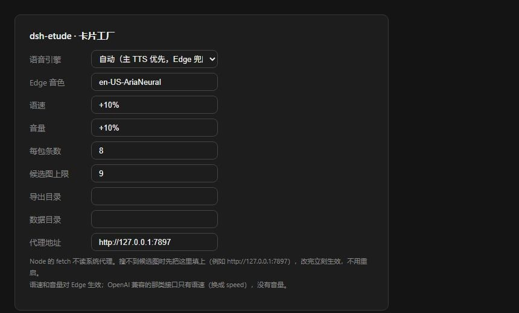

插件列表上那一行还会显示一行摘要，不用点进去也能看到关键值：

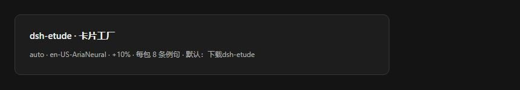

| 字段 | 默认 | 什么时候要改 |
| --- | --- | --- |
| 语音引擎 | `auto` | `auto` = 配了主 TTS 就先试它、失败退 Edge；`edge` = 只用 Edge；`openai` = 只用 OpenAI 兼容（失败也退 Edge，不会没声音） |
| Edge 音色 | `en-US-AriaNeural` | 想换男声/英音：`en-US-GuyNeural`、`en-GB-SoniaNeural`…（完整列表走 `voice.list`，这是从微软那端点拉的，不是硬编码的七个） |
| 语速 | `+10%` | 默认比常速快一点。太赶就 `+0%` |
| 音量 | `+10%` | 只对 Edge 生效 |
| 每包条数 | `8` | 1–40 |
| 候选图上限 | `9` | 3–12。九宫格正好九个 |
| 导出目录 | 空（= 下载\dsh-etude） | 想直接导到 Anki 的媒体目录就填那 |
| 数据目录 | 空（= `%LOCALAPPDATA%\dsh-etude`） | 想放 D 盘、或者放同步盘 |
| **代理地址** | 空 | **搜不到图时第一个要看的**。填 `http://127.0.0.1:7897` 这种，改完立刻生效，不用重启 |

只在配置文件里能改的（还没做成界面字段）：`language`（目前只有 `en`）、`zhVariants`（3）、`provider` / `model`（不填就跟随当前会话的默认模型）、`autoPrepareCandidates`、`pixelCheck`、`ttsBaseUrl`、`ttsApiKeyEnv`、`ttsModel`、`ttsVoice`。

**key 不要填在这里。** `ttsApiKeyEnv` 填的是一个**环境变量名**（默认 `OPENAI_API_KEY`），真正的 key 由 Harness 的凭据服务去解析 —— 插件不保存任何明文密钥。

---

## 13. 让 Agent 帮你造包

面板不是唯一入口。会话里直接说，比如：

> 给我造一个 coffee 的包，先不用找图

它会调 `etude_create`。三个工具长这样：

| 工具 | 参数 | 干什么 |
| --- | --- | --- |
| `etude_create` | `target`（必填）、`kind`、`examples`、`prepareImages` | 造例句（顺带可选地找候选图），返回 `packId` 和一句人话总结 |
| `etude_status` | `packId`（可不填） | 列出所有包，或者某一条的详情：哪几条缺图、哪几条缺音 |
| `etude_pack` | `packId`（必填）、`export` | 打包装；`export: true` 顺带导出 |

注意 `etude_create` 回来的总结里会明确写「**配图还没人挑，语音还没人试听**」—— 这不是客套话，是当前状态。它不会替你点图。

典型的一次调用：

```
etude_create { target: "commute", prepareImages: false }
→ { packId: "7d4076e8a82b4a3d", status: "text", summary: "commute 的包造好了，8 条例句…配图还没人挑，语音还没人试听。" }
```

---

## 14. 命令行

```powershell
# 整条链路自检：假模型出句子 → 真去 Commons 搜图 → 真跑 Edge → 打包 → 导出 → 再验一遍
node tests/selftest.mjs --target coffee --examples 3 --candidates 6 --export

# 单元（18 条）：mp3 时长、判型、提示词、Edge token 回归钉子、哈希
node --test tests/unit.test.mjs

# 面板渲染冒烟（4 个状态：有包 / 空 / 连不上 / 侧栏图标）
node tests/client-smoke.mjs

# RPC 冒烟（49 项）：界面会调的每个端点按真实顺序走一遍
node tests/rpc-smoke.mjs

# 契约（16 条）：含「纯色块会被拒」「没有复核记录会被拒」两条反证
python -m pytest tests/test_contract.py -q

# 一条命令跑前三个
npm test
```

`selftest.mjs` 用假模型（不花钱）但**图库和语音是真的**，所以能验出真问题。`--keep` 保留临时目录方便看产物。

---

## 15. 出问题了

| 症状 | 原因 | 怎么办 |
| --- | --- | --- |
| 面板一片空白 | 宿主半没激活，或 `state` 端点挂了 | 插件列表确认 `active`；`etude_status` 试一下；改过代码记得 disable→enable |
| 左边有图标，点进去「连不上宿主」 | 宿主半崩了 | 看 Harness 日志；重载 `include:etude` |
| 「没有可用的模型（no-llm）」 | 当前会话没配默认模型 | 设置里选一个模型，或者给插件配置写 `provider`/`model` |
| 造例句一直失败 | 模型回的 JSON 抽不出来 | 看报错里的 `problems`；换个目标词试；模型换强一点的 |
| 搜不到候选图 | **没配代理**（最常见）/ Openverse 挂了 | 设置页填代理；Openverse 连错三次本次进程就不再用它，Commons 一般还在 |
| 九宫格全是「图没取回来」 | 取字节的 RPC 失败 | 刷新页面；确认不是宿主半重启过 |
| 「合成语音」转很久 | Edge 网络问题 | 重试；Edge 通了会有声 |
| 语音文件有了但放不出来 | 文件坏了 | 「重新合成」；它不认非 mp3 的字节 |
| 打包被拒 | 缺图/缺试听/缺复核 | 报错里写了第几条，照着补 |
| 挑图时提示「这张照片第 3 条已经在用了」 | 同一张照片不许在一个包里出现两次 | 换一张。「找全部候选图」已经自动避开重复，看到这句说明是手动重复挑了 |
| 导出报「导出目录不对」 | 目标目录不在导出根下，或名字不是 `<slug>-<id>` | 别手改导出目录名，换一个干净的导出根 |
| 导出报 `export-invalid` | 副本没过校验 | 源包还在，重新导一次；连续失败就自己跑 `python contract/validate.py <包目录>` 看细节 |
| 造第二个包同一个词，没花钱也没变 | 命中了幂等键（这是设计） | 想重造：先把旧包删掉，或者改 `examplesPerLesson` / 音色 / 语速这类进幂等键的参数 |

---

## 16. 数据在哪

```
%LOCALAPPDATA%\dsh-etude\
├── factory\
│   ├── library.json          # 账本：所有包的元数据（原子写）
│   ├── media\images\         # 选定的图，内容寻址
│   ├── media\audio\          # 合成好的 mp3，内容寻址
│   ├── candidates\           # 还没挑的候选缩略图（暂存）
│   └── packs\<包id>\         # 打好的包
└── staging\<包id>\           # 打包中间态（校验不过时会留着）
```

- **备份**：整个 `dsh-etude` 目录拷走就够。`library.json` 是唯一的状态真源，媒体文件按内容寻址，不会因为改名而失联。
- **迁移**：把目录拷到新机器，把设置里的「数据目录」指过去。
- **删干净**：面板里删包（会连带删媒体引用计数降到 0 的文件）；整个目录删掉 = 全部重置。
- **别手动改 `library.json`**：它可能在写入时被你覆盖。真要改，先关插件。

导出目录和上面这些是两回事：`Downloads\dsh-etude\` 里是**成品副本**，删了不影响插件里的数据，重新导一次就有了。

---

## 17. 附录：契约硬校验清单

打一个包要过这些，一条不过就不是成品：

| 检查 | 要求 |
| --- | --- |
| `format` | `card-pack`（老值 `etude-lesson` 认，但给 warning） |
| `format_version` | 精确 `2` |
| `generator.kind` | 精确 `dsh-plugin` |
| `lesson.target` | 非空 |
| `lesson.language` | 白名单，当前只有 `en` |
| `lesson.voice.engine` / `voice` | 非空 |
| `examples` | 1–40 条 |
| `sentence` | 非空，≤ 400 字 |
| `scene_en` / `scene_zh` | 非空，各 ≤ 600 字 |
| `zh_variants` | 2–4 个 |
| `review.image.by` | **必须有值** |
| `review.audio.by` + `listened` | **必须有值且为 true** |
| 媒体文件 | 必须存在，且 `sha256` 与文件实际哈希一致 |
| 图片 | 短边 ≥ 640，字节 ≤ 4 MB |
| 音频 | 字节 > 0，时长 > 0 |
| 句子 | casefold 去重，同一句不许出现两次 |
| 同一媒体文件 | 只许出现一次 |
| 路径 | 不许 `..`、不许绝对路径 |

---

## 18. 术语

| 词 | 意思 |
| --- | --- |
| 卡片包 / pack | 一个目标词的全套材料，一个目录 |
| 实例 / 一条 / example | 包里的一条卡片：一句 + 一张图 + 一条音 |
| 候选 / candidate | 搜出来还没被选的图，在暂存里 |
| 锁定 / pick | 你点了「用这张」，图从候选变成这条卡片的正式图 |
| 复核 / review | 图点过、音听过留下的记录。没有它，包不能打包 |
| 场景 / scene | 什么情况下说这句话。**不是翻译** |
| 幂等键 | 一组参数的哈希，命中就复用，不重复花钱 |
| 内容寻址 | 文件名 = 内容哈希，同一份字节只存一次 |

---

动手顺序建议：先照第 4 节造一个 `coffee`，把第 6、7 节的挑图和试听各走一遍，第 9 节导出一次。走完这四步，剩下的都只是重复。
