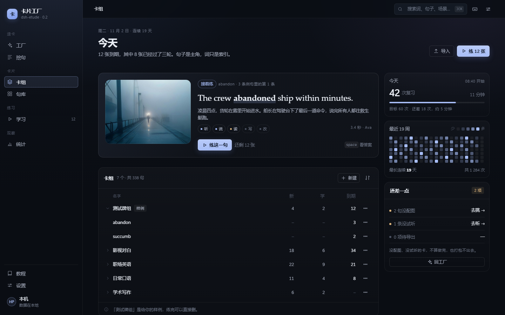
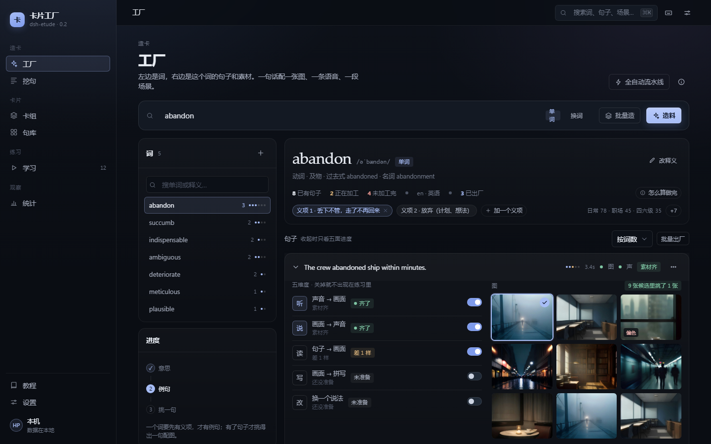
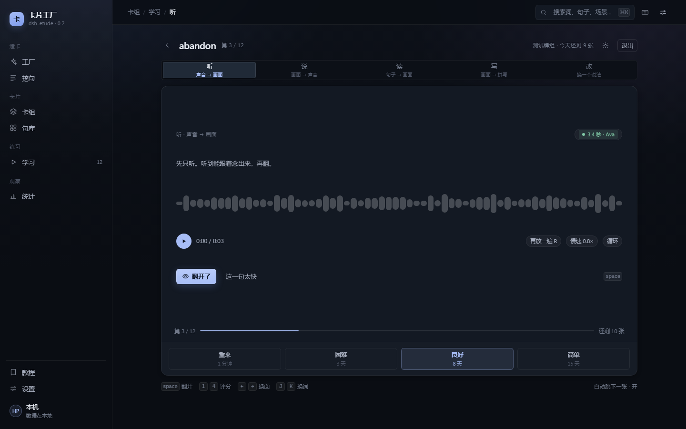
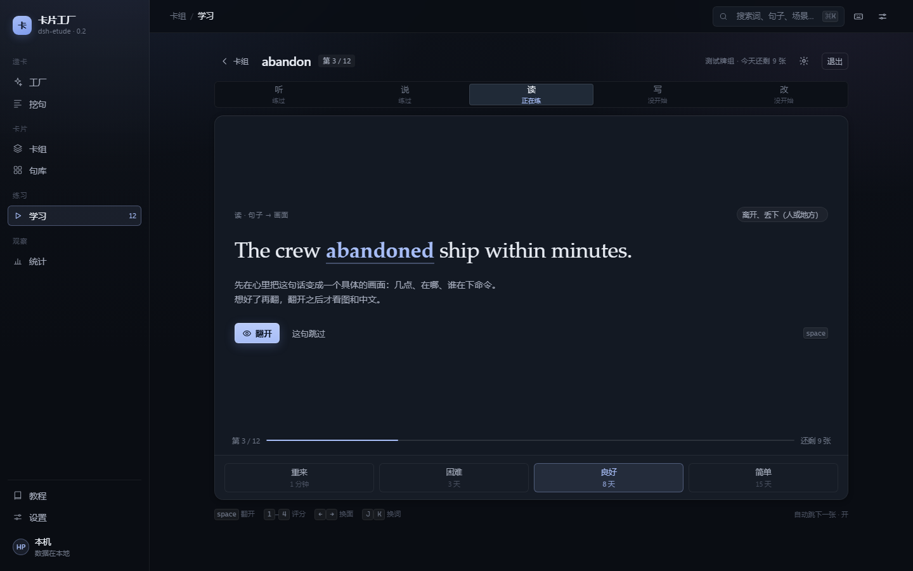
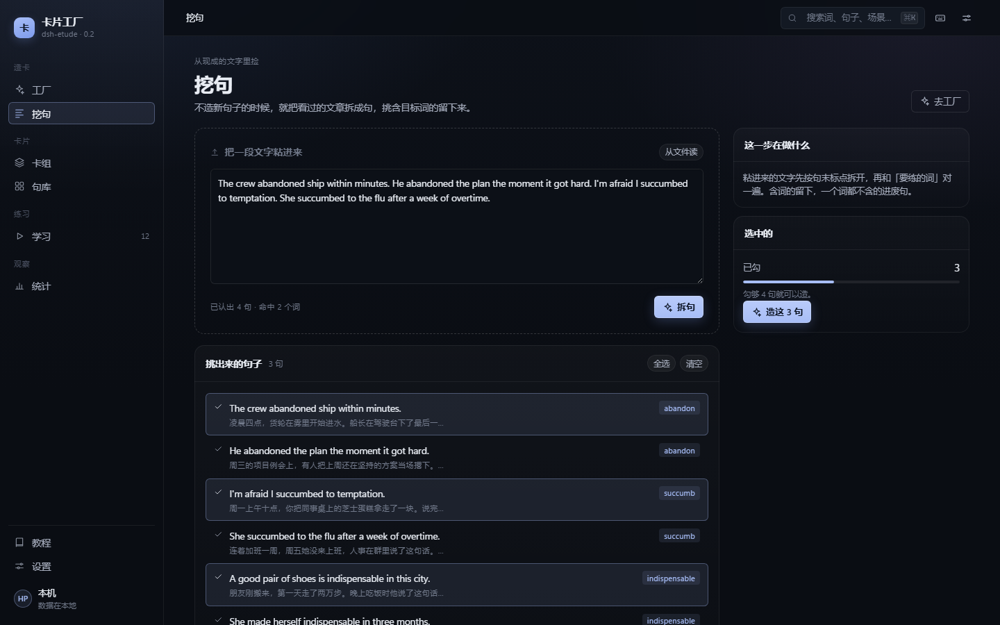
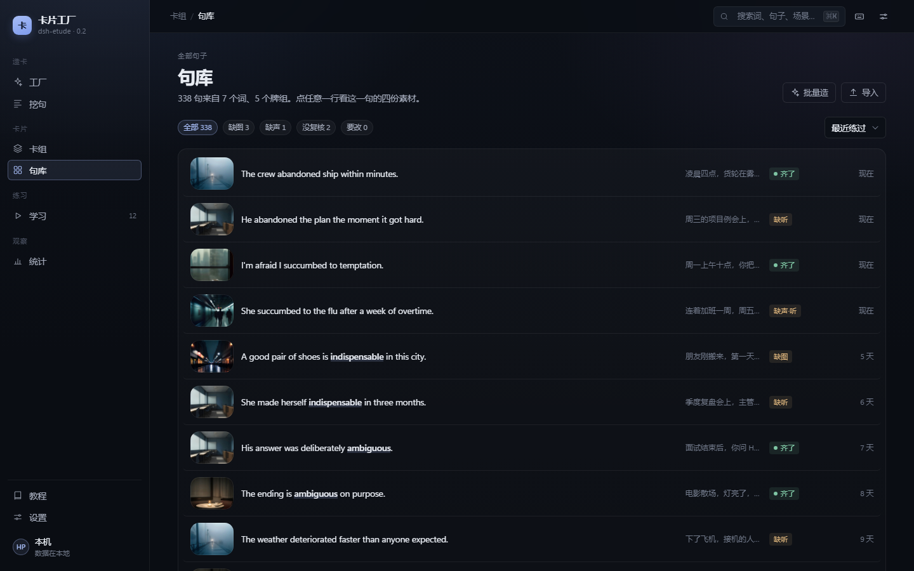
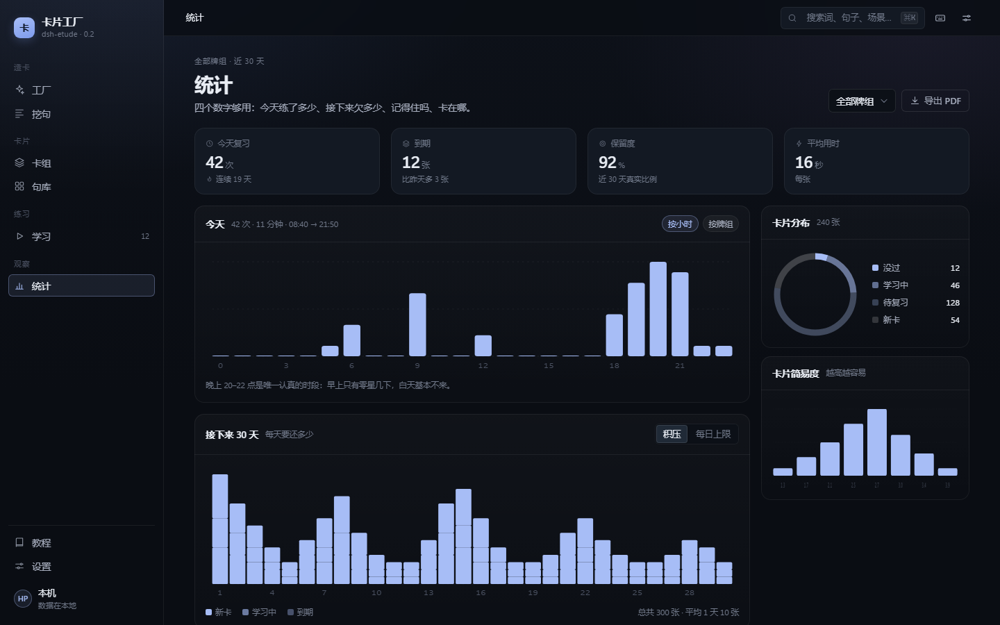
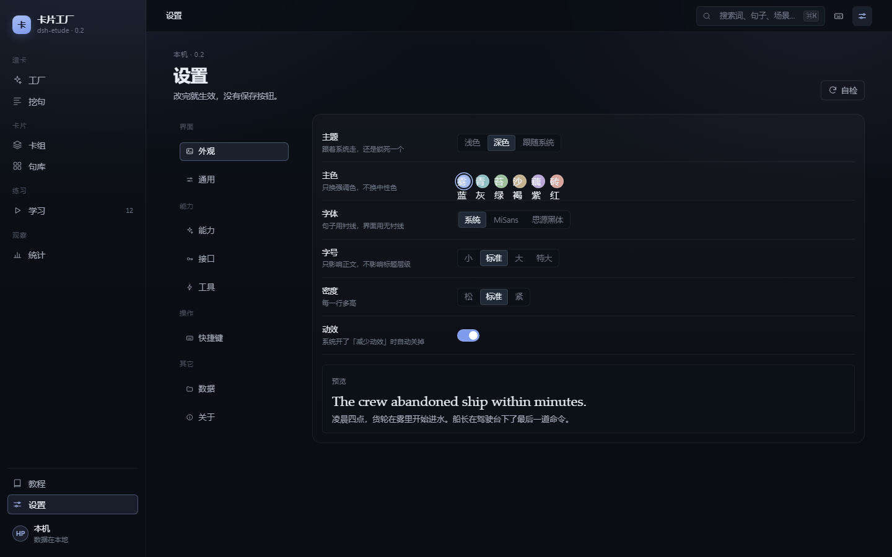

# 卡片工厂 · 使用手册

> 一个词、一个固定说法，或者一整句进去；出来是一整套能练、能听、能看的卡片。
> 这本手册对应 0.2 版界面（左侧栏四组 / 十五个页面）。



## 0. 三条硬规矩

这三条不是建议，是代码里拦着的：

1. **每张图必须有人点过头。** 搜到的候选先过体检，再进九宫格；有人在九宫格里点了「用这张」、
   点了锁定，才写得进清单。没有「自动入库」这条路。
2. **每条语音必须真播过。** 播放进度到 60%，「我听过了」才允许点；没点就打包，打包会拒绝，
   并说清第几条。
3. **同一个东西不重复花钱。** 幂等键 =（词、类型、条数、模型、提示词版本、音色）。
   第二次按「造料」不发请求，直接返回已有那份——界面上表现为「秒回」。

机器（Agent 工具、命令行）批量跑出来的包，清单里写 `auto:not-human`，界面标「样例」，
只能看效果，不算交付物。

## 1. 装之前

- Node ≥ 22.19（`node -v` 看一眼）。
- 要外网：搜图走 Openverse / Wikimedia Commons，语音走 Edge TTS 的 WebSocket。
- 在公司网里要配代理。Node 不读系统代理，本项目自己读注册表里的 `ProxyServer`
  （常见 `127.0.0.1:7897`），设置页「接口」里也能手填。

## 2. 装进 Harness

```bash
npm install                                  # 只装 sharp + ws
plugin_manager install_bundle target:"F:\\path\\to\\dsh-etude"
```

装好之后三种办法确认：

1. 左边图标栏多了一个「卡」。
2. 插件列表里 `dsh-etude` 是 active。
3. 让 Agent 调 `etude_status`，能返回数据目录和包列表。

改了代码要重载：`plugin_manager set_plugin target:"include:etude" enabled:false`，
再 `enabled:true`（一次 set 不会重挂）。面板半（`client.js`）改了还要刷新浏览器。

## 3. 界面地图

左边栏四组，一共十五页。演示稿在 `design/`，`node gen.mjs` 可重建。

| 组 | 页 | 干什么 |
| --- | --- | --- |
| 造卡 | 工厂 `factory` | 输入词 → 义项 → 例句 → 五维度 → 图与声 |
| 造卡 | 挖句 `mine` | 把现成的文章拆句，挑含目标词的留下来 |
| 卡片 | 卡组 `cards` | 今天该练什么、牌组树、待办 |
| 卡片 | 句库 `library` | 所有句子摊开，按「缺图 / 缺声 / 没试听」筛 |
| 练习 | 学习 `study` | 一屏一张，五面轮着来 |
| 观察 | 统计 `stats` | 今天练了多少、接下来欠多少、记得住吗 |
| — | 教程 `tutorial` | 三分钟走完一条产线 |
| — | 设置 `settings` | 十一个分区，改完就生效 |

五个单面页（`listen` / `speak` / `read` / `type` / `vary`）是学习页的五面单独摊开，
用来对照「每一面到底给什么」。

## 4. 造第一个包



1. 顶部输入框填一个词，比如 `abandon`。
2. 判型是自动的：有句末标点、开头是 I/you/he/she/we/they/this/there/who，或者 6 词以上，
   就当整句处理；剩下的按「一个词 / 固定说法」处理。
3. 选条数（默认 8），按「造料」。

造的是**句子**，不是翻译。每一条都要交代：谁在说、在哪、什么时候、说完会怎样。
八条例句的场景互不相同，这是硬要求。

确定性校验会拦四种情况，不过就带着问题重试一次，还不过就报错，不悄悄降级：

- 句子里没有目标词；
- 两条句子重复；
- 场景为空，或者直接把句子抄进场景；
- 两条场景的字面相似度 > 0.86。

## 5. 挑一张图

候选图先过体检，过不了的**根本不进九宫格**：

| 项 | 线 |
| --- | --- |
| 短边 | ≥ 640 |
| 体积 | ≤ 4 MB |
| 文件头 | 真的对得上 jpg/png/webp（嗅探，不看扩展名） |
| 亮度标准差 | ≥ 6（防纯色图） |
| 二阶差分 | ≥ 1.1（防渐变图） |
| 量化色数占比 | ≥ 0.02 |

九宫格里单击选中、双击锁定；也可以「自己上传」。锁定之后文件名变成
`来源-哈希前20位.jpg`，卡片右下角出现「换一张」——换图会让这句退回「没做完」，
旧图留在候选池里，不删。

## 6. 听一遍语音



- 默认 Edge TTS，纯 JS 实现，零配置。
- 引擎设成「自动」时，先试 OpenAI 兼容接口；失败就退 Edge，并把 `fellBackFrom` /
  `fellBackReason` 记在包里，界面上能看到「这次是退回来的」。
- 一条一条听，听到 60% 才允许点「我听过了」。没听过的语音，导出会拒绝。

## 7. 打包

打包前跑一遍硬校验：缺图、缺人工复核、哈希不对，都会拒绝，并说清第几条差什么，
比如「第 3 条的配图没人确认」「第 5 条语音还没试听」。

校验过了才生成 `manifest.json` + `images/` + `audio/`，拷到 `factory/packs/<id>`。

## 8. 导出

默认导到 `Downloads\dsh-etude\<词>-<id>\`。顺序是：清空目标目录 → 拷 → **拿副本再验一遍**。
两处都过才算「已复验」，界面上有横幅。导出记录写在清单里，打回制卡不会动已经导出的那份。

## 9. 练一张卡



一屏一张卡，不分栏。顶部五面：听 / 说 / 读 / 写 / 改，每面给的东西不一样：

| 面 | 给什么 | 怎么算过 |
| --- | --- | --- |
| 听 | 只有声音（波形、时长、再放一遍） | 能跟着念出来 |
| 说 | 只有图 | 对着图讲一遍，录音回放 |
| 读 | 只有句子 | 先想画面，再翻开 |
| 写 | 图 + 中文 | 拼出来（逐字符给反馈） |
| 改 | 句子 + 改写区 | 换一个说法，同一件事不许变 |

「灰掉不代表禁掉」：虚线框是这一面不鼓励先看，点开就变蓝底实线。

评分四档，带下次间隔：重来 1 分钟 / 困难 3 天 / 良好 8 天 / 简单 15 天。
评完 260 毫秒自动跳下一张（可以关）。

## 10. 挖句



粘一段文章、剧本、播客逐字稿进去。分隔符自动认（换行、逗号、顿号、分号、斜杠、制表符）。
拆出来的句子和「要练的词」对一遍，含词的留下，勾选后一次造完。

## 11. 句库



所有句子一行一句，五列：缩略图、句子、场景、状态、到期。状态只有四种：
图缺、声缺、没试听、齐了。点任何一行看这一句的四份素材。

## 12. 统计



四个数字够用：今天复习多少次、到期多少张、保留度、平均用时。
下面是：今天按时段、未来 30 天要还多少、保留度曲线、卡片分布、简易度分布、复习热力图。

## 13. 设置



十一个分区，左边选一个，右边只剩这一类。改完就生效，没有保存按钮。

| 分区 | 有什么 |
| --- | --- |
| 外观 | 主题、主色、字体、字号、密度、动效 |
| 通用 | 学习语言、界面语言、每包条数（1–40）、候选图上限（3–12）、自动备料、自动跳下一张 |
| 能力 | 模型、提示词版本、场景相似度阈值、重试次数 |
| 接口 | 语音引擎、音色、语速、音量、接口地址、key 的环境变量名 |
| 工具 | 三个 Agent 工具的开关 |
| 快捷键 | 分四组：全局 / 页面 / 练习 / 音频 |
| 数据 | 数据目录、导出目录、备份、清候选图 |
| 关于 | 版本、契约版本、校验器、许可 |

**key 不进配置。** 这里只填环境变量名（默认 `OPENAI_API_KEY`），凭据由 Harness 保管。

## 14. 给 Agent 用的三个工具

| 工具 | 干什么 |
| --- | --- |
| `etude_create` | 造一个包，返回「还要人做什么」 |
| `etude_status` | 看某个包做到哪一步、还差什么 |
| `etude_pack` | 硬校验后打包，缺件就拒绝 |

工具的总结里会明写「配图还没人挑，语音还没人试听」——不要把它当成做完了。

## 15. 数据在哪

```
%LOCALAPPDATA%\dsh-etude\
  factory\library.json    主索引（包、例句、复核记录）
  factory\packs\<id>\     打包后的成品
  candidates\             候选图（没锁定的会被「清候选图」清掉）
  audio\                  语音
```

写 json 一律先写临时文件再改名，中途断电不会把索引写坏。

## 16. 契约（card-pack v2）

打包前必过校验，三份实现必须一致：

- `contract/validate.js`（Node）
- `contract/validate.py`（Python）
- `contract/manifest.schema.json`（schema）

硬校验清单：`format` 必须是 `card-pack`（老的 `etude-lesson` 只发警告）、
每条都要有 `image` 和 `audio`、`review.by` 非空、哈希对得上、
`quality.flat_images` 必须是 0。

导出的副本也要复验一遍——副本过不了就不算导出成功。

## 17. 故障对照

| 现象 | 大概是 |
| --- | --- |
| 装完左边没图标 | 没重载：`include:etude` false → true |
| 面板白屏 | 看 Host 控制台；多半是 `client.js` 语法错 |
| 搜图一直 0 张 | 代理没通，或 Openverse 504（会退 Commons） |
| 播放键没声也不报错 | 文件名不对：语音是 `edge-<20hex>.mp3`，别拿只认图片扩展名的校验函数去验 |
| 打包说「配图没人确认」 | 九宫格里点了没锁，或者从没点过 |
| 导出说「副本没过校验」 | 目标目录写了一半，重导一次 |

## 18. 术语

- **五面**：听 / 说 / 读 / 写 / 改，是五种练法。
- **六块材料**：背景、图·资源、句子、声音、录音、打字，是卡片里能翻的东西。
  六块材料 ≠ 五个面。
- **义项**：一个词的一种意思，带情境概率和调音。义项是结构单位，例句挂在义项下。
- **变体**：同一条例句的另一种说法。只做一层，不派生，不产新卡，只开读 / 写两面。
